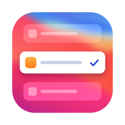
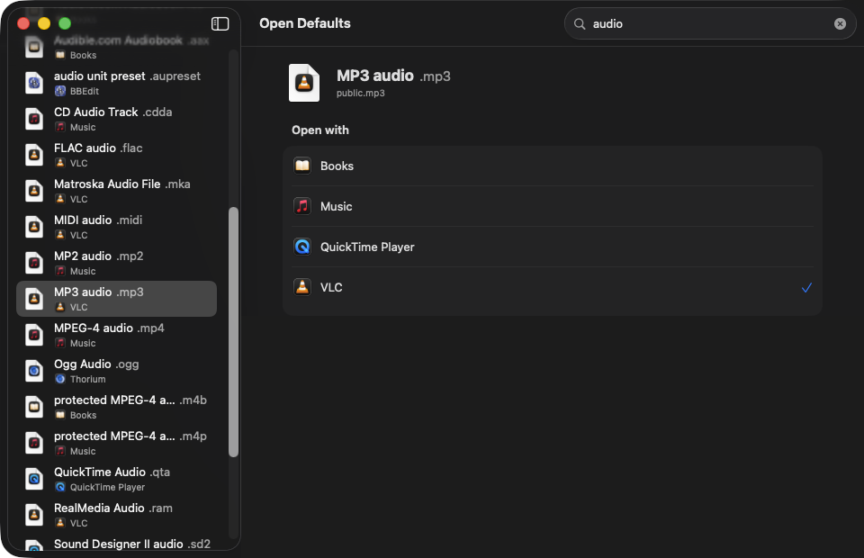

<div align="center">



# Open Defaults

**Choose which app opens each file type on your Mac.**

*Named after two Terminal commands, `open` and `defaults`. No Terminal needed.*




</div>

## Features

- **Every file type in one list.** Common types plus every type your installed apps declare, each showing its current default app.
- **Search.** Filter by name, extension or type identifier. Press <kbd>⌘</kbd><kbd>F</kbd> to jump to the search field.
- **One click to change.** Pick an app from the **Open with** list. macOS asks you to confirm, and the app shows whether the change worked.
- **Two ways back.**
  - **Restore Previous** returns to the app you had just before your last change.
  - **Restore Original** returns to the app the type used before you first changed it here. It is remembered across launches.
  - <kbd>⌘</kbd><kbd>Z</kbd> undoes the last change.
- **Clear states.**
  - no search results
  - no app can open this type
  - you clicked *Keep* in the macOS prompt
  - the change failed
  - the default app was moved or deleted
- **Native and private.** Sandboxed, with no network access and no third-party code. Supports VoiceOver, keyboard navigation, Reduce Transparency and Increase Contrast.

## Requirements

- macOS 26 or later
- Xcode 26 or later, to build from source

## Build and run

```sh
git clone <this repo>
cd open-defaults
open DefaultApps.xcodeproj   # then Run (⌘R)
```

From the command line:

```sh
scripts/build.sh build/dd     # Debug build
scripts/test.sh build/dd      # unit tests
open build/dd/Build/Products/Debug/DefaultApps.app
```

To install, build the Release configuration and copy the app to `/Applications`:

```sh
xcodebuild -project DefaultApps.xcodeproj -scheme DefaultApps -configuration Release -derivedDataPath build/rel build
ditto build/rel/Build/Products/Release/DefaultApps.app "/Applications/Open Defaults.app"
```

Builds are signed ad hoc ("Sign to Run Locally"). To give the app to other people, sign it with your own Developer ID and notarize it.

## How it works

Open Defaults uses only public Apple APIs:

| Task | API |
|---|---|
| Read the default app | `NSWorkspace.urlForApplication(toOpen:)` |
| List apps that can open a type | `NSWorkspace.urlsForApplications(toOpen:)` |
| Set the default app | `NSWorkspace.setDefaultApplication(at:toOpen:)` |
| Describe file types | `UniformTypeIdentifiers` |

The **Restore Original** record lives in the app's sandboxed `UserDefaults`.

## Known limits

These come from what macOS allows:

- **Every change asks for confirmation.** macOS shows its own "Use / Keep" prompt for each change. Open Defaults can't skip it.
- **"Automatic" can't be restored exactly.** If macOS was choosing the app automatically, Restore Original sets the same app again as an explicit choice. It opens files the same way, but macOS now treats it as your pick. There's no public API to clear a default.
- **The type list is assembled.** macOS has no "list every file type" API, so the list combines common types with the types your installed apps declare.
- **Changes made elsewhere show on focus.** A change made in Finder or another tool appears when you switch back to the app, or when you press <kbd>⌘</kbd><kbd>R</kbd>.

## Developer scripts

| Script | Purpose |
|---|---|
| `scripts/check-default.swift <uti> [--expect <bundle id>]` | Print a type's default and candidates; exits non-zero on mismatch |
| `scripts/set-default.swift <uti> <app path>` | Set a default from the terminal (shows the macOS prompt) |
| `scripts/snapshot-defaults.swift <uti>…` | Print a markdown table of the defaults for these types |
| `scripts/window-shot.swift <out.png>` / `--bounds` | Screenshot the app window or print its frame |

The app icon is rendered from `design/icon/concepts.html` (`?v=v2&bg=blur`) with headless Chrome.

## License

[MIT](LICENSE)
